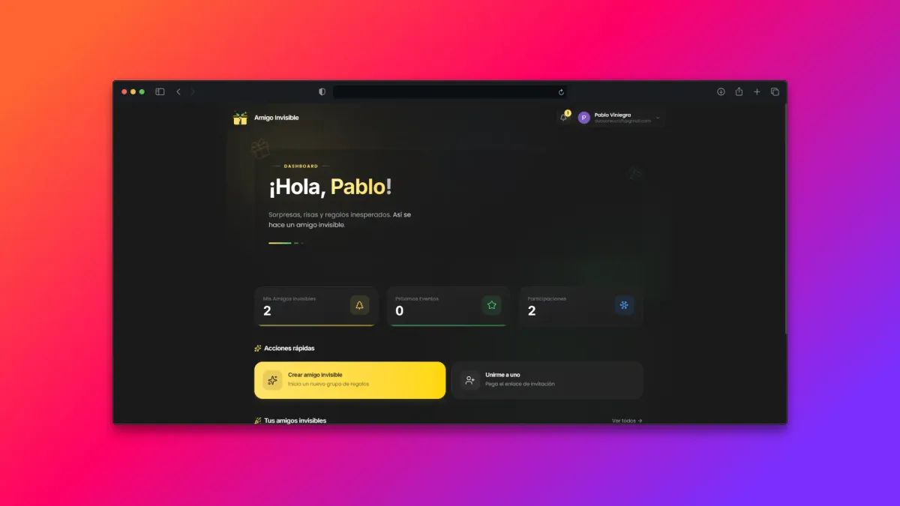
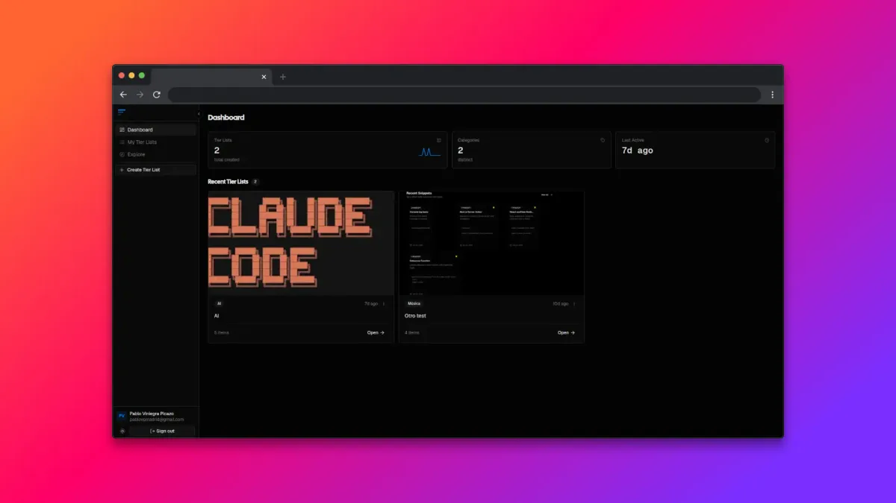
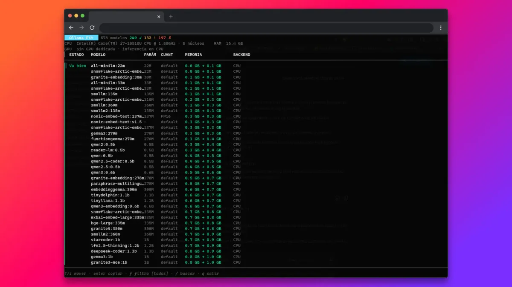
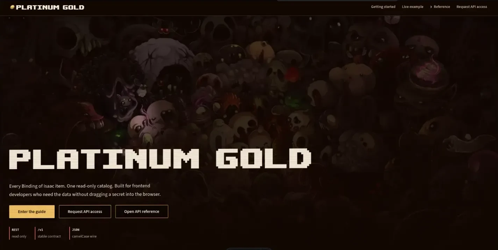

  
  
  
  

Hago aplicaciones web, modernizo las que ya existen y trabajo con agentes dentro del repositorio. A veces todo eso significa averiguar por qué un componente se ha renderizado otra vez.

Trabajo en **Minsait (Indra) para BBVA** con Vue.js, React y Python. Por aquí encontrarás proyectos personales, herramientas de terminal y alguna excusa para abrir otro repositorio.

  
   
  <em>Cuando el bug desaparece al poner un console.log.</em>

## Mi relación con el código heredado es seria

En el trabajo me toca mejorar aplicaciones que la gente ya está usando. El botón tiene que seguir funcionando mientras cambiamos lo que hay debajo.

<table>
  <tr>
    <td width="33%" valign="top">
      <h3>-35 %</h3>
      tiempo de carga en 4 aplicaciones internas de BBVA con más de 10.000 usuarios diarios.
    </td>
    <td width="33%" valign="top">
      <h3>12 % → 65 %</h3>
      cobertura de tests en código heredado. Donde antes había fe.
    </td>
    <td width="33%" valign="top">
      <h3>Vue 2 → 3</h3>
      migración de 3 aplicaciones críticas mantenidas por un equipo de 12 personas.
    </td>
  </tr>
</table>

- Optimizo la carga de datos y el renderizado. Que React pueda volver a renderizar no significa que deba hacerlo.
- Preparo flujos de trabajo con agentes para que el equipo pueda usarlos desde el repositorio.
- Antes, en **Imagar**, desarrollé integraciones para AENA y más de 15 aerolíneas, además de automatizaciones con Azure y Power Platform.

## El «ya que estamos» hecho repositorio

<table>
  <tr>
    <td width="50%" valign="top">
      
      <h3>🎁 Santa App</h3>
      
El Amigo Invisible parece fácil hasta que aparecen las parejas, las exclusiones y el «a mí me tocó esa persona el año pasado». Eventos, reglas del sorteo, listas de deseos y avisos por correo.

      
<code>Nuxt</code> <code>Vue</code> <code>TypeScript</code> <code>PostgreSQL</code> <code>Drizzle</code> <code>Better Auth</code>

      
<a href="https://santa-app.pabloviniegra.dev/">Probar</a> · <a href="https://pabloviniegra.dev/projects/santa-app">Caso de estudio</a>

    </td>
    <td width="50%" valign="top">
      
      <h3>🏆 Tier Maker</h3>
      
Para poner cosas en tier S y discutirlo después. Editor de tier lists con presets, exportación a PNG, recuperación local del trabajo, exploración pública y likes.

      
<code>Next.js</code> <code>React</code> <code>TypeScript</code> <code>PostgreSQL</code> <code>Drizzle</code> <code>Better Auth</code>

      
<a href="https://tiermaker.pabloviniegra.dev/">Crear una tier list</a> · <a href="https://pabloviniegra.dev/projects/tier-maker">Caso de estudio</a> · <a href="https://github.com/PabloViniegra/tier-maker">Código</a>

    </td>
  </tr>
  <tr>
    <td width="50%" valign="top">
      
      <h3>🦙 Ollama-Fit</h3>
      
Antes de descargar otro modelo que no cabe en tu equipo, mejor echar cuentas. TUI, comandos <code>fit</code>, <code>local</code> y <code>doctor</code>, salida JSON y binarios multiplataforma. Son estimaciones, no benchmarks: la RAM no se amplía por optimismo.

      
<code>Go</code>

      
<a href="https://github.com/PabloViniegra/tui-ollama-go/releases">Descargar</a> · <a href="https://pabloviniegra.dev/projects/ollama-fit">Caso de estudio</a> · <a href="https://github.com/PabloViniegra/tui-ollama-go">Código</a>

    </td>
    <td width="50%" valign="top">
      
      <h3>🗝️ Platinum Gold</h3>
      
API de solo lectura con el catálogo de ítems de The Binding of Isaac, y una web de documentación que la consume sin dejar la clave en el navegador. Contrato <code>/v1</code> estable y caché Redis invalidada por generación.

      
<code>FastAPI</code> <code>PostgreSQL</code> <code>Redis</code> <code>Docker</code> <code>Astro</code> <code>React</code>

      
<a href="https://platinum-gold-frontend.vercel.app/">Ver la documentación</a> · <a href="https://pabloviniegra.dev/projects/platinum-gold">Caso de estudio</a> · <a href="https://github.com/PabloViniegra/platinum-gold-backend">Código</a>

    </td>
  </tr>
</table>

<strong>Más cosas del taller</strong>

 

| Proyecto | Qué hace | Stack |
| --- | --- | --- |
| [**SQLito**](https://github.com/PabloViniegra/sqlito) | Cliente SQLite para la terminal donde el SQL es la interfaz. Historial, favoritos y export a CSV. En npm como `@pablo-v/sqlito`. | TypeScript · Ink · SQLite |
| [**PkgSense**](https://github.com/PabloViniegra/pkgsense) | Extensión de VS Code que revisa tu `package.json` (seguridad, peso, licencias, paquetes abandonados) y te avisa con diagnósticos y quick fixes. | TypeScript · VS Code API |
| [**Spanish Elections Simulator**](https://spanish-elections-simulator.pabloviniegra.dev/) | Reparte los 350 escaños del Congreso con D'Hondt en 52 circunscripciones. Cada escenario se comparte con un enlace, sin backend. | Next.js · React · TypeScript |

## Los agentes también necesitan leer el README

Uso **Claude Code**, MCPs y Agent Skills para escribir código, revisar cambios y operar sobre repositorios. También trabajo con OpenCode y GitHub Copilot CLI para tareas puntuales.

En BBVA he implantado un flujo agéntico compartido por el equipo, aplicado a migraciones y testing de código heredado. Las instrucciones, skills, hooks y servidores MCP forman parte del flujo del repositorio.

> El agente propone. Los tests y la revisión tienen algo que decir.

Algunas Agent Skills que he publicado:

| Skill | Para qué |
| --- | --- |
| [`better-init`](https://github.com/PabloViniegra/better-init) | Un `/init` más preciso: genera un `CLAUDE.md` o `AGENTS.md` breve y con señal. |
| [`tell-me-the-domain`](https://github.com/PabloViniegra/tell-me-the-domain) | Reconstruye el dominio de negocio de un código desconocido a partir del repositorio. |
| [`architecture-advisor`](https://github.com/PabloViniegra/architecture-advisor) | Recomienda una arquitectura según stack y dominio, o audita la existente y propone migrarla por pasos. |
| [`clean-my-code`](https://github.com/PabloViniegra/clean-my-code) | Audita calidad y mantenibilidad con evidencia, y no toca nada sin tu aprobación. |
| [`eu-legal-compliance-audit`](https://github.com/PabloViniegra/eu-legal-compliance-audit) | Preauditoría técnica de RGPD, cookies, EAA, AI Act y DSA. No es asesoramiento legal. |
| [`improve-prompt`](https://github.com/PabloViniegra/improve-prompt) | Convierte peticiones vagas en prompts listos para un agente, con criterios de aceptación. |

[Cómo trabajo con agentes y qué he aplicado en el equipo →](https://pabloviniegra.dev/#ai)

## La caja de herramientas

**Para lo que se ve**

**Para lo que responde detrás**

**Para que llegue a producción**

  

## La terminal no miente

  
  

## ¿Hablamos?

Estoy disponible para unirme a un equipo de producto. Si quieres hablar de un proyecto, de código heredado o de por qué ese test solo falla en CI, escríbeme.

Hecho con <a href="https://www.gitskins.com/">GitSkins</a> · tema <code>summer</code>, en ámbar como <a href="https://pabloviniegra.dev/">mi portfolio</a>.

